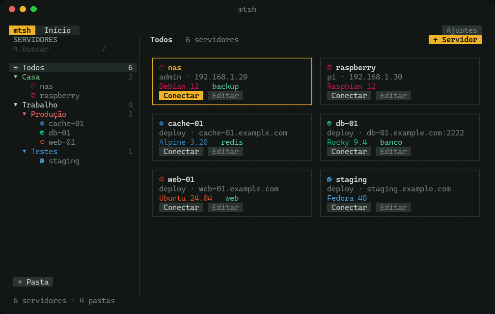

# mtsh

Gerenciador de conexões SSH no terminal, com cara de aplicativo.



Seus servidores ficam organizados em pastas, aparecem como cards com o logo da distro, e cada conexão abre numa aba dentro do próprio mtsh. Tudo no terminal, com teclado ou mouse.

> A interface do mtsh é em português.

## Recursos

- **Pastas** com ícone e cor, aninhadas como você quiser.
- **Cards** com o logo da distro de cada servidor (Ubuntu, Debian, Mint, Red Hat, Rocky, Fedora, Arch, Alpine e outras). O mtsh detecta a distro na primeira conexão.
- **Abas de sessão:** cada conexão abre numa aba, e dá pra ter várias ao mesmo tempo. `vim`, `htop` e companhia funcionam dentro delas.
- **Cadastro simples:** senha, chave colada na hora, ou automático (ssh-agent e `~/.ssh/config`).
- **Busca** por nome, IP, pasta ou tag.
- **Usa o `ssh` do sistema:** suas configurações, chaves e `known_hosts` continuam valendo.

## Instalar

```sh
curl -fsSL https://raw.githubusercontent.com/missa-thecreator/mtsh/main/install.sh | sh
```

O instalador:
- detecta o sistema e baixa a versão mais recente;
- confere o checksum;
- instala em `~/.local/bin`;
- pergunta se você quer instalar os ícones das distros.

Funciona no **Linux** e no **macOS** (Intel e ARM). No **Windows**, use dentro do **WSL**.

Prefere instalar na mão? Baixe o pacote do seu sistema em [Releases](https://github.com/missa-thecreator/mtsh/releases) e rode:

```sh
./install.sh --from mtsh_<versão>_linux_amd64.tar.gz
```

### Ícones das distros

Quem desenha os logos é a fonte do terminal, e o mtsh já traz as fontes necessárias dentro dele. Pra instalar, abra os **Ajustes** (tecla `,`) ou rode `mtsh --instalar-icones`.

- **WSL:** instala as fontes no Windows e configura o Windows Terminal e o terminal do VS Code. Antes de editar cada configuração, guarda uma cópia como `settings.json.bak-mtsh`.
- **Linux e macOS:** instala a fonte de símbolos no seu usuário. Se o terminal não usar ela sozinho, coloque `Symbols Nerd Font Mono` como fonte de reserva.

Se preferir não instalar fonte, escolha **Bolinha na cor da distro** nos Ajustes.

## Usar

```sh
mtsh
```

| Tecla | O que faz |
|---|---|
| `enter` | conectar (abre numa aba) |
| `t` | conectar em tela cheia |
| `a` / `e` / `d` | novo, editar, apagar servidor |
| `n` | nova pasta (`e` numa pasta edita nome, ícone e cor) |
| `/` | buscar |
| `ctrl+b` | numa aba de sessão, volta pro Início |
| `1`–`9` | no Início, vai pra aba |
| `,` | ajustes |
| `q` | sair |

### Onde ficam os dados

Tudo fica em `~/.config/mtsh/`:

- `hosts.yaml`: servidores e pastas.
- `keys/`: chaves coladas no mtsh (permissão 600).
- `passwords.json`: senhas salvas (permissão 600, legível só pelo seu usuário, como as chaves em `~/.ssh`).

Não coloque `keys/` nem `passwords.json` em backup público ou em repositório de dotfiles.

## Compilar do código

Precisa de Go 1.23.

```sh
git clone https://github.com/missa-thecreator/mtsh.git
cd mtsh
go run .                                  # rodar
go run . --config ./hosts.example.yaml    # com servidores de exemplo
go test ./...                             # testes
./scripts/build.sh v0.2.0                 # pacotes em dist/
```

Releases são publicadas pelo GitHub Actions: cada tag `vX.Y.Z` enviada compila os pacotes e cria a release.

## Contribuir

Issues e pull requests são bem-vindos. Antes de abrir um PR, rode `go vet ./...` e `go test ./...`.

## Licença

[MIT](LICENSE). Pode usar, modificar e distribuir à vontade, mantendo o aviso de copyright.

As fontes embutidas mantêm as licenças originais, que vão em cada pacote: Cascadia Mono NF (SIL Open Font License, Microsoft) e Symbols Nerd Font (MIT).
